<p align="center">
  <picture>
    <source media="(prefers-color-scheme: dark)" srcset="docs/brand/logo-dark.svg">
    
  </picture>
</p>

**shuto helps you get your photos ready for Shutterstock, on your own computer.** It checks your
photos, writes the titles and keywords, makes sure they follow Shutterstock's rules, and uploads
them. You stay in charge.

<p align="center">
  
</p>

## What it does for you

- **You pick the photos.** Choose a folder. Your original files are never changed.
- **It checks the quality.** Blurry, too dark or too small photos are set aside.
- **AI writes titles and keywords.** The AI runs on your own computer, and you can edit everything.
  Neutral wording by default; a **Region focus** option in Settings adds Japan-specific help.
- **It checks Shutterstock's rules.** It warns you about things like logos or people that can
  cause a rejection.
- **It uploads for you.** One click sends your approved photos to Shutterstock.
- **You press Submit yourself.** The last step on the Shutterstock website is always yours.

## Install

Paste one line, no admin rights needed. Step-by-step help with pictures:
[docs/install.md](docs/install.md).

**Windows** (open PowerShell):

```
irm https://raw.githubusercontent.com/alamhanz/shuto/main/install/install.ps1 | iex
```

**macOS and Linux** (open Terminal):

```
curl -LsSf https://raw.githubusercontent.com/alamhanz/shuto/main/install/install.sh | sh
```

When it finishes, shuto opens in your browser and a **shuto** icon appears on your Desktop.
This installs the latest release ([all releases](https://github.com/alamhanz/shuto/releases)).
Prefer to install from a downloaded copy? See
[Install from a downloaded copy](docs/install.md#install-from-a-downloaded-copy).

## Using shuto

1. Double-click the **shuto** icon. A page opens in your browser.
2. The first time, a short setup helps you pick the AI and, if you like, save your Shutterstock
   login. Keys for online AI are entered in **Settings**, not in a terminal.
3. Click **Add photos** and choose your folder.
4. Click **Check**. shuto checks the photos and writes titles and keywords.
5. **Review** the results. Fix anything you like, then approve the photos.
6. **Upload**, then press **Submit** on the Shutterstock website.

Every screen tells you what to do next. More detail: [docs/web-guide.md](docs/web-guide.md).

Learn more: [how shuto works in detail](docs/details.md).

## Uninstall

Pick one:

**Windows** (PowerShell):

```
irm https://raw.githubusercontent.com/alamhanz/shuto/main/install/uninstall.ps1 | iex
```

**macOS and Linux** (Terminal):

```
curl -LsSf https://raw.githubusercontent.com/alamhanz/shuto/main/install/uninstall.sh | sh
```

Or, in any terminal where shuto works: `shuto uninstall`.

- **Removed:** the shuto program, its icons, and your saved Shutterstock login.
- **Kept:** your photos (never touched), and your shuto data (batches and settings) unless you
  choose to delete it when asked.
- **Stays on your computer:** Ollama and any AI models you downloaded. Remove them like any
  other app if you no longer want them.

Details: [docs/install.md](docs/install.md#uninstall).

## Privacy

shuto is local-first. Your photos and everything shuto learns about them stay on your computer.
Nothing leaves it unless you choose an online AI (then the photos you check are sent to that
company) or you upload to Shutterstock.

## Found a problem?

Please [open an issue](https://github.com/alamhanz/shuto/issues/new/choose). There are simple
forms for a [bug report](https://github.com/alamhanz/shuto/issues/new?template=bug_report.yml),
a [feature idea](https://github.com/alamhanz/shuto/issues/new?template=feature_request.yml) and
a [Shutterstock rule update](https://github.com/alamhanz/shuto/issues/new?template=restriction_update.yml).
Say what you did and what you saw. No technical knowledge needed.

shuto is an independent project and is not affiliated with or endorsed by Shutterstock.

<details>
<summary><strong>For developers</strong></summary>

### Setup

Python 3.12 or newer, on Linux, macOS or Windows.

```
git clone https://github.com/alamhanz/shuto.git
cd shuto
python -m venv .venv
# activate: source .venv/bin/activate  (Linux/macOS)  or  .venv\Scripts\activate  (Windows)
pip install -e ".[dev]"
```

Optional extras: `anthropic`, `gemini`, `bedrock` (API providers), `heic` (HEIC/HEIF photos),
`all`. Install one with, for example, `pip install -e ".[anthropic,heic]"`.

### Test and lint

```
pytest -q
ruff check . ; ruff format .
```

### How it is built

Python, FastAPI + Jinja2 + htmx for the local web app (127.0.0.1:8765 only), SQLite, Pillow.
The default AI is a local model through [Ollama](https://ollama.com); Anthropic, Gemini and
Bedrock are optional. The pipeline is: collect, cull, describe, guardrails, prepare (IPTC/XMP),
deliver (FTPS + CSV), track. The Shutterstock portal is never automated.

### Command line

Everything the web app does is also available as a command. `shuto COMMAND --help` shows flags.

```
shuto init                 # workspace, hardware and model choice
shuto run ./my-photos      # import + cull + describe
shuto                      # start the web app
```

| Command | Purpose |
|---|---|
| `ui`, `init`, `doctor` | start the web app; set up; check hardware, Ollama and models |
| `models` | `list`, `pull TAG`, `use SPEC`, `bench [MODEL]` |
| `import`, `cull`, `describe`, `run` | the early stages, or all three with `run` |
| `review`, `edit`, `approve` | inspect and change metadata |
| `prepare`, `upload`, `export`, `submitted` | delivery (`upload` is off unless `deliver.upload_enabled` or `--yes`) |
| `status`, `accept`, `reject` | tracking |
| `ledger export/import` | back up or restore the already-uploaded list (`uploaded.csv`) |
| `secrets set NAME`, `check-ftps` | store a secret (the web app does this in Settings); test the upload login |
| `restrictions` | `list` rules or `check TEXT` |
| `shortcut`, `uninstall` | create or remove icons; uninstall shuto |

### Configuration and secrets

Copy [shuto.example.yaml](shuto.example.yaml) to `shuto.yaml` and pass it with `--config`.
Secrets never go in the config: use environment variables, a `.env` file or the OS keyring
(`SHUTO_FTPS_USER`, `SHUTO_FTPS_PASSWORD`, `ANTHROPIC_API_KEY`, `GEMINI_API_KEY`; Bedrock uses
the normal AWS credentials). Model choice order: CLI flag, UI or `shuto models use`, config,
then `auto`.

### More

- [docs/local-models.md](docs/local-models.md): choosing a local model
- [docs/shutterstock-restrictions.md](docs/shutterstock-restrictions.md): the rules shuto checks
- [CONTRIBUTING.md](CONTRIBUTING.md) and [SECURITY.md](SECURITY.md)
- The earlier AWS version is kept at the git tag `aws-legacy`.
- The benchmark image `src/shuto/data/sample.jpg` is CC0; see
  [src/shuto/data/SAMPLE_CREDIT.md](src/shuto/data/SAMPLE_CREDIT.md).

</details>

## License

[MIT](LICENSE), copyright 2026 Alamsyah Hanza.
